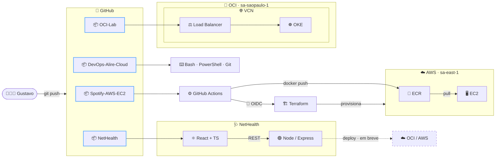

<!--

  

-->

 My name is Gustavo, and I’m a technology professional passionate about smart solutions, automation, and continuous learning. Currently, I work in the cloud infrastructure team, dealing with migration projects, internal and external support, virtualized environments, and databases. I also have experience in web development, client support, and collaboration with engineering and product teams. Over the past few months, I’ve been deepening my knowledge in the following areas: Cloud Computing: fundamentals, architecture, and cloud providers such as Azure and AWS. DevOps: culture, agile practices, CI/CD, automation, and process integration. Containerization ande Databases.

 

  

  
  
  

  🌎 <b>Português</b> (nativo) · <b>English</b> (intermediário) &nbsp;|&nbsp; 📋 Scrum/Kanban · ERP · CRM

  
  
  
  
  
  

### 🗺️ Arquitetura dos Projetos

<!--

  
   
  

-->

<!--

-->
